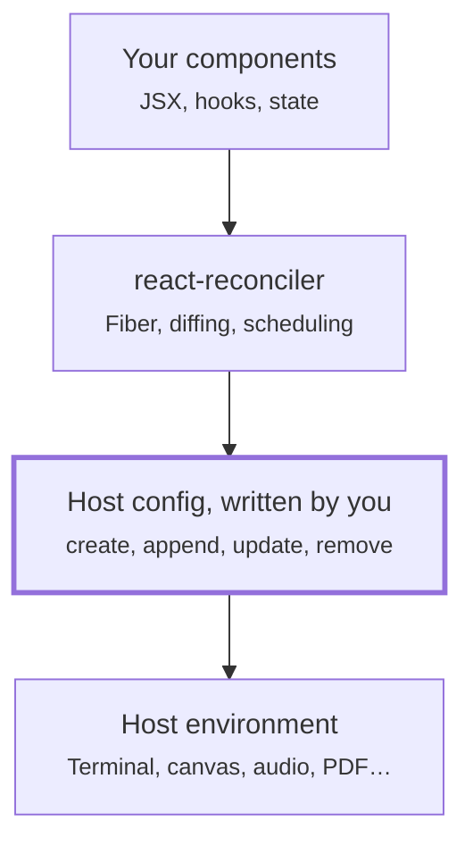

# Learning React from the inside, one custom renderer at a time

A personal study plan: build renderers on top of `react-reconciler`, starting with a plain object tree and ending with a small react-dom. No copied solutions; every line written by hand.

> A styled version of this guide lives in [`react-renderers-guide.html`](./react-renderers-guide.html).

## Contents

- [Why build a renderer](#why-build-a-renderer)
- [Practice roadmap](#practice-roadmap)
- [How to work](#how-to-work)
- [Sources](#sources)

## Where a renderer sits

## Why build a renderer

Using React every day teaches you its API. Writing a renderer teaches you its contract: the exact moment React stops thinking and asks the platform to do something. React DOM, React Native, Ink, react-three-fiber and react-pdf all sit on the same package, `react-reconciler`. Each one supplies a "host config", an object of methods the reconciler calls to create, attach, update and remove host instances.

That makes the host config the cleanest window into React's engine. Every call it receives is a decision the reconciler has already made, so by watching and implementing those calls you learn how rendering, reconciliation, keys, commits and effects really behave.

### Two phases to keep in mind

The **render phase** works out what should change. It must stay pure and can be interrupted or thrown away. The **commit phase** applies the changes to the host, all at once. Many host config methods only make sense once you know which phase calls them.

### Two modes to choose from

In **mutation mode** you change host instances in place, the way the DOM works. In **persistent mode** you build new immutable trees, as React Native's newer architecture does. Mutation mode is the one to start with; it's far easier to reason about.

## Practice roadmap

Nine renderers, ordered by complexity. Each step adds one or two new ideas on top of the previous ones, so you're never learning two hard things at once.

| # | Renderer | What you build | New concepts |
|---|----------|----------------|--------------|
| 1 | Plain object tree | Host instances are plain JS objects; the "screen" is a JSON tree printed after each commit. Every surprise is a React surprise. | host config basics, mount, text instances, root container |
| 2 | Markdown or HTML string | Serialize the tree into a document. Mostly static. | serialization, where text is allowed |
| 3 | Terminal, in the spirit of Ink | `<Box>` and `<Text>` drawn to stdout and redrawn on each commit. | updates, repaint after commit, keyboard input as events |
| 4 | Slack, Discord or spreadsheet output | Render into a strict external schema you don't control. | validating children, mapping props to a schema |
| 5 | Canvas 2D | `<Rect>`, `<Circle>`, `<Group>`. The canvas keeps no tree, so you keep your own. | retained tree, batched repaints, hit-testing, keyed reordering and z-order |
| 6 | Web Audio | Oscillators inside gain nodes, mapped onto the audio graph. | non-visual graph, fine-grained updates, cleanup on unmount |
| 7 | Hardware: LEDs or an Arduino | A slow, side-effectful host. Shows why commit is separate from render. | async hosts, side effects at commit |
| 8 | 3D with three.js | The react-three-fiber idea. | external render loop, GPU resource disposal, generic prop application, refs to host objects |
| 9 | Mini react-dom | Rebuild a small subset of react-dom, then compare with the real one. | attributes vs properties, styles, event delegation and bubbling, controlled inputs |

Progress:

- [ ] 1. Plain object tree
- [ ] 2. Markdown or HTML string
- [ ] 3. Terminal
- [ ] 4. Slack, Discord or spreadsheet output
- [ ] 5. Canvas 2D
- [ ] 6. Web Audio
- [ ] 7. Hardware
- [ ] 8. 3D with three.js
- [ ] 9. Mini react-dom

## How to work

### Instrument before you implement

Make every host config method log its name and arguments before it does anything else. Render a small tree, trigger a state change, remove a child, reorder a keyed list, and read the log. Ask why the calls happen in that order.

### Grow features in a fixed order

Static mount, then text, then prop updates through state, then removals, then keyed reordering, then events, then refs and effects, then Suspense and concurrent rendering. Each step pulls in a new group of host methods.

### Match versions and trust the README

`react-reconciler` must match your `react` version. The host config API changed noticeably between React 18 and 19, and many tutorials predate that. When a tutorial and the README for your installed version disagree, the README and the type definitions win.

### Read source when stuck, not before

Struggle with your own implementation first, then read the matching explanation. Setting a breakpoint inside your `createInstance` and reading the call stack is a good way to discover the reconciler's own files.

### Questions to answer for yourself

- Why are there both `appendInitialChild` and `appendChild`?
- Why is an instance created during render but only attached to the root at commit?
- What does `shouldSetTextContent` change about the tree?
- Why does the reconciler call you before and after each commit?
- When do keys turn a remove-and-create into a move?

## Sources

Grouped in a suggested reading order. Pair each roadmap step with the matching deep dive after you've tried it yourself.

### Build the mental model

Read these before writing any code.

- **[React as a UI Runtime](https://overreacted.io/react-as-a-ui-runtime/)**, Dan Abramov. Explains React through host trees, host instances and renderers, the same vocabulary the reconciler uses.
- **[Render and Commit](https://react.dev/learn/render-and-commit)** and **[Preserving and Resetting State](https://react.dev/learn/preserving-and-resetting-state)**, react.dev. Short official pages on the two phases and why tree position and keys matter.
- **[React Fiber Architecture](https://github.com/acdlite/react-fiber-architecture)**, Andrew Clark. Written before Fiber shipped, so some details are dated, but still the clearest account of why Fiber exists.

### Custom renderers

Your primary references while building.

- **[react-reconciler README](https://github.com/facebook/react/tree/main/packages/react-reconciler)**. The official, best-effort documentation. The package is marked experimental and doesn't follow React's versioning, so read the README for your installed version.
- **[ReactFiberConfig.custom.js](https://github.com/facebook/react/blob/main/packages/react-reconciler/src/forks/ReactFiberConfig.custom.js)**. The full list of methods a host config can provide. The real source of truth.
- **Host configs inside React:** [ART](https://github.com/facebook/react/blob/main/packages/react-art/src/ReactFiberConfigART.js), [DOM](https://github.com/facebook/react/blob/main/packages/react-dom-bindings/src/client/ReactFiberConfigDOM.js), [Native](https://github.com/facebook/react/blob/main/packages/react-native-renderer/src/ReactFiberConfigNative.js). React ART's is the smallest and most readable; start there.
- **[Building a Custom React Renderer](https://www.infoq.com/news/2020/01/react-conf-2019-custom-renderer)**, Sophie Alpert, React Conf 2019. The best short introduction; the talk itself is on YouTube. Its update methods predate React 19, so cross-check with the README.
- **Real renderers:** [Ink](https://github.com/vadimdemedes/ink), [react-three-fiber](https://github.com/pmndrs/react-three-fiber), [react-pdf](https://github.com/diegomura/react-pdf). Readable production code for when you're stuck on a specific step.
- **[awesome-react-renderer](https://github.com/chentsulin/awesome-react-renderer)**. A long list of community renderers to browse for ideas.

### React internals

For when you want to see the reconciler's side of the contract.

- **[React Internals Deep Dive](https://jser.dev/)**, JSer. A thorough walkthrough of React's source: mounting, re-rendering, hooks, Suspense, bailouts and tree traversal, each with a post, a video and a debugging session. Read the overview, mount and re-render episodes before you implement updates.
- **[The diffing algorithm for arrays](https://jser.dev/react/2022/02/08/the-diffing-algorithm-for-array-in-react)**, JSer. Read just before keyed reordering in the canvas renderer.
- **[Build your own React](https://pomb.us/build-your-own-react/)**, Rodrigo Pombo. Rebuild a mini React with Fiber and hooks. The complementary path: your renderers teach the platform side, this teaches the React side.
- **[The React repository](https://github.com/facebook/react/tree/main/packages)**. Look in `react-reconciler/src` for the work loop, `beginWork`, `completeWork` and the commit files. `react-noop-renderer` is React's own minimal test renderer, an official cousin of roadmap step 1.

> **Note:** APIs and links reflect React 19 and the state of these resources in October 2026. If something has moved, the React repository and the README of your installed `react-reconciler` are the places to check first.
